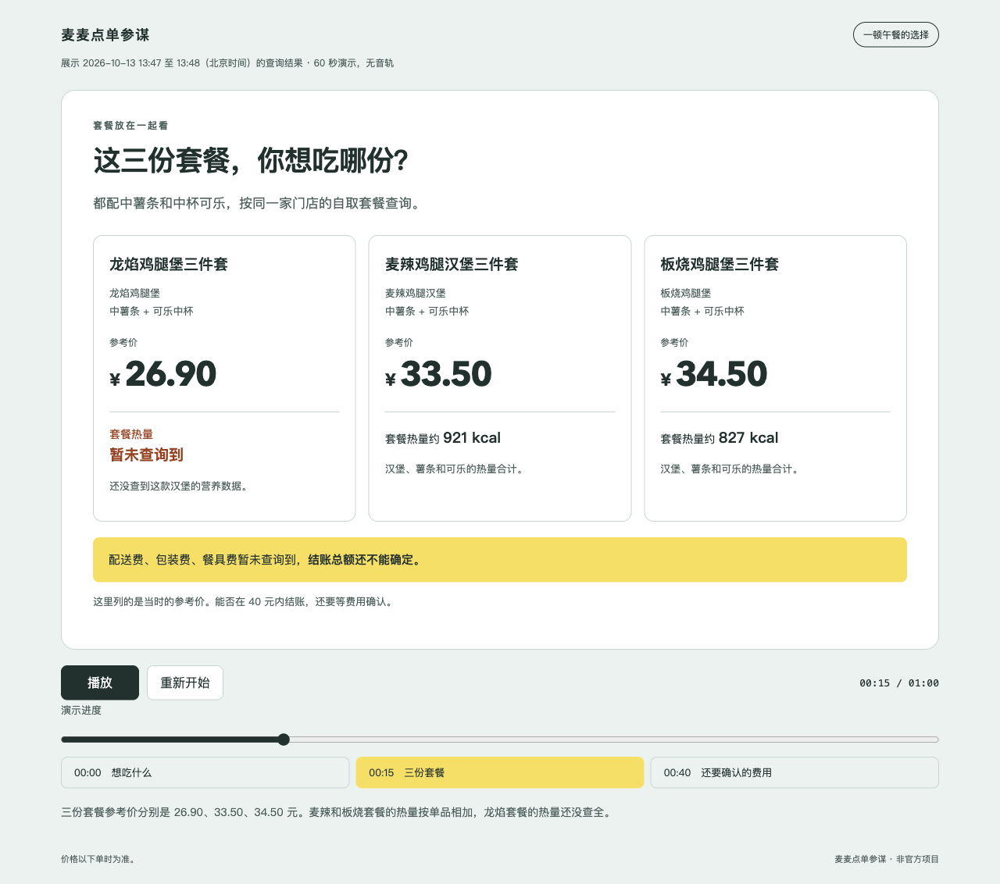

# 麦麦点单参谋：凑券不凑亏

帮你挑餐、算清含配送费实付，再由你分别确认领券和创建待支付订单。适合已配置麦当劳 MCP 的 Agent 用户；非麦当劳官方产品。

核心问题：**为了满减加一份，最后会不会反而多付？** 只在官方优惠条件和两份完整报价都明确时给结论，缺数据就说明「暂未查询到，仍待确认」，内部状态保持 `unknown`。钱包、营养目标、口味三种排序及随机推荐都以当前工具数据和用户主动偏好为依据。

## 用一分钟看看怎么选餐

[直接打开并播放演示](https://imulan.top/mai-mai-order-advisor/) · [HTML 源文件](docs/demos/readonly-2026-10-13/index.html) · [需求截图](docs/demos/readonly-2026-10-13/01-context.png) · [参考价截图](docs/demos/readonly-2026-10-13/02-reference-prices.png) · [未知信息截图](docs/demos/readonly-2026-10-13/03-unknown-fees.png)

点击上方在线入口，再点“播放”，无需 Token。也可下载或克隆仓库，用浏览器打开 `docs/demos/readonly-2026-10-13/index.html` 离线播放。支持暂停、重新开始、进度拖动和章节切换，无音轨。

GitHub Pages 仅发布该演示目录；`main` 上的演示内容或部署工作流变更会自动更新站点。页面展示一次查询的结果，不会更新价格或替你点餐。

演示使用 2026-10-13 13:47 至 13:48（北京时间）的真实查询结果：一个人，预算 40 元，想吃鸡肉，到店自取。三份套餐来自上海同一家营业门店，都配中薯条和中杯可乐。

| 候选 | 查询时参考价 | 套餐热量 |
| --- | ---: | --- |
| 龙焰鸡腿堡三件套 | ¥26.90 | 暂未查询到：缺少汉堡的精确营养匹配 |
| 麦辣鸡腿汉堡三件套 | ¥33.50 | 约 921 kcal，按三个单品记录相加 |
| 板烧鸡腿堡三件套 | ¥34.50 | 约 827 kcal，按三个单品记录相加 |

**配送费、包装费、餐具费均暂未查询到，完整费用仍待确认。** 参考价不是最终实付，不能保证 40 元内结账；本次门店券与卡包查询均为空，不作凑券省钱结论。快照不代表后续价格，实际使用时需重新查询。



### 此演示已验证的范围

- 11 次真实只读查询成功：门店、菜单、门店券、卡包、营养各 1 次，套餐详情与计价各 3 次；已核对默认商品、数量、小计，以及营养匹配或缺项。
- 浏览器已验证三段播放、终点停止、暂停、重新开始、章节切换和键盘进度控制；桌面截图已查看，手机宽度下无横向溢出，减少动态效果模式生效。
- 页面与截图只保留脱敏摘要，没有凭据、账号、地址、订单号或支付链接；播放不请求麦当劳接口。查询和演示全程未领券、未下单、未支付。

完整结账费用、凑券是否划算，以及领券下单流程仍未验证。安装和交易限制见下方“验证与能力边界”。

## 30 秒离线模拟演示

Python 3.10+，仅标准库，无需 Token、pip 或网络。在项目根目录运行：

```sh
python3 -m copilot demo
python3 -m unittest discover -s tests -v
python3 scripts/check_project.py
python3 -m compileall -q copilot tests scripts
```

演示输出全部是**模拟数据，不是官方响应**：

| 模拟场景 | 原车实付（含费） | 加购后实付（含费） | 规则结论 |
| --- | --- | --- | --- |
| 原商品 30 元，配送 6 元；加购后商品 42 元、减 10 元、配送 6 元 | 36 元 | 38 元 | 不值得凑，多付 2 元 |
| 同样商品和券，但另一次模拟报价配送费明确为 0 元 | 36 元 | 32 元 | 少付 4 元 |
| 缺官方门槛/适用条件 | — | — | unknown，不猜节省金额 |

演示还走完整的「领全部券确认 → 卡包刷新 → 重算 → 具体订单确认 → 模拟创建 → 读回待支付」状态机。自动输入确认仅限该合成演示。示例链接使用 `example.invalid`，没有真实支付作用。

## 推荐与凑券解释

- **算清多花在哪里**：比较结果拆出商品、配送、其他费用和优惠的净支出变化。例如加购 12 元、增加优惠 10 元、费用不变，实际多付 2 元。
- **尊重明确排除**：不喜欢的标签从三种榜单和随机池中排除；“再换一个”支持传入本轮已展示的候选 ID，候选耗尽时解释原因。
- **说明为什么推荐**：结果卡带商品明细、门店、报价时间与来源、预算余量、匹配喜好和热量目标偏差；未知营养继续显示未知。
- **指出还缺什么**：费用缺项会列出具体字段，每个排除候选有原因；不把缺失费用当零，也不在证据不足时给省钱结论。

离线 CLI demo 包含“排除牛肉、跳过已展示候选”及缺费用场景。接口用法见 [推荐契约](references/contracts.md#recommend)；该 CLI 演示使用原有合成 fixture，与上方真实查询快照分开。

## 安装与使用 Skill

1. 保留本目录整体结构，将其作为名为 `mai-mai-order-advisor` 的 Skill 文件夹导入支持本地 Skill 的 Agent 主机；入口是根目录 [SKILL.md](SKILL.md)。如果主机只支持指定技能目录，由你把整个文件夹放入该主机的技能目录，不只复制 SKILL.md。也可在支持读取本地文件的主机中明确要求读取本路径 SKILL.md 并遵循它。具体技能发现方式由主机决定，本项目没有修改任何全局配置。
2. 在主机配置官方麦当劳 MCP，连接地址 `https://mcp.mcd.cn`，Streamable HTTP。真实 Token 由你在主机本地通过环境变量 `MCD_MCP_TOKEN` 提供，不发到聊天、不放项目 `.env`、不把真值写入配置文件。
3. [mcp-config.example.json](mcp-config.example.json) 是活动规则要求的脱敏配置示例，便于在支持环境变量替换的主机中试用。不同主机的变量引用方式可能不同，使用前确认主机的安全注入方式，不得将真实 Token 写入配置或提交到仓库。
4. 确认主机可见当前工具 Schema，按 [MCP_INTEGRATION.md](MCP_INTEGRATION.md) 适配。启用主机对写工具的逐次审批。

Codex 本地安装可将整个项目目录软链接到 `~/.agents/skills/mai-mai-order-advisor`，保留入口引用的代码和文档；先检查目标不存在，已有安装不覆盖。项目目录移动会使链接失效。Codex 会自动发现技能变化，下一轮可按名称调用；若没有出现，再重启主机。发现目录与软链接行为见 [OpenAI 官方说明](https://learn.chatgpt.com/docs/build-skills#where-codex-loads-local-skills)。

示例请求：

> 使用麦麦点单参谋，按我选定的门店外送，一人预算 40 元，喜欢鸡肉。给我钱包、600 kcal 目标和口味三种方案，缺数据请明确说未知，先不要领券或下单。

> 比较当前购物车和为满减加一份后的实付，包含配送费；不确定券资格时别猜。

> 随机挑一个满足我预算和忌口的候选，先展示详情和报价。

> 不喜欢牛肉，刚才这份也先跳过。再换一个；如果没有符合条件的，就告诉我原因。

领券会先说明「绑定全部当前可领券」并等待独立确认；领券后重新查卡包与报价。下单前再次展示具体门店、商品、规格、券、费用、总价和履约信息，等待确认口令。创建后读回状态，付款由你在官方流程完成。推荐不等于领券授权，领券授权不等于下单授权。

## 文件与接口

- [设计](docs/design.md)：三种基础架构比较、选择理由、数据流和取舍。
- [SKILL.md](SKILL.md)：便携 Agent 入口；[内部契约](references/contracts.md) 按需读取。
- `copilot/core.py`：含费报价校验、同车/加购比较、三种排序与随机。
- `copilot/workflow.py`：双确认、刷新、报价及参数绑定、单次意图、读回状态。
- `copilot/__main__.py`：离线演示及 stdin JSON 接口；`fixtures/demo.json` 为明确标记的合成数据。
- `tests/`：价格证据、营养未知、交易闸门与 CLI 集成测试。
- [官方来源记录](docs/official-sources.md)：声明原文获取方式及验证局限。

对会话内真实数据优先调用 Python 内存 API；CLI 可读 stdin JSON，输出也只留私密会话，不保存到项目或日志。辅助代码不实现官方参数 Schema、HTTP 连接或主机工具拦截。

## 验证与能力边界

2026-10-12 已备份并修正主机认证配置：`bearer_token_env_var` 引用环境变量名 `MCD_MCP_TOKEN`。备份校验、配置解析和启动检查通过；新后端与当前聊天均恢复 11 个只读工具，当前聊天的时间查询及再次试价成功。凭据与私密配置备份未进入项目。

当日 21:52–21:55（北京时间），按「到店自取、一人预算 40 元、喜欢鸡肉」重跑营业门店、当前菜单、套餐详情、营养和实时试价。三个候选均返回报价，其中两份默认套餐营养可完整匹配，另一份保留未知；识别出会员卡附条件菜单价，未将其当作不购卡的实际价格。具体结果见 [只读复验记录](docs/validation.md#认证修正后的只读复验)。费用缺项仅作提示：可展示接口返回总价，本次不据此作完整含费推荐或凑券结论。

离线回归和项目检查结果见 [验收记录](docs/validation.md)。上述项目检查命令不访问网络或真实 MCP；静态检查覆盖语法、基础格式、文档链接、声明快照和启发式敏感信息扫描，不等于完整类型检查或安全审计。

2026-10-13 在当前 Codex 主机建立本地 Skill 软链接，新启动的验证代理在技能目录中发现并读取入口及引用文件，安装目录的静态检查通过。主聊天显式读取已安装入口，完成三个候选的真实只读查询与参考价展示；费用缺项显示「暂未查询到，完整费用仍待确认」，不生成完整含费榜单。本次未验证桌面技能选择器、重启后的独立聊天自动激活或真人审批界面。

优惠资格和真实订单链路仍未验证。内核状态机输出意图，实际执行由主机负责；它不防止恶意伪造来源/state 或主机绕过 Skill。主机必须从真人消息提取确认、按顺序消费最新 state 并启用写工具审批。跨会话状态丢失或写超时不重试，先在官方渠道核实。

没有自动付款、取消/退款、地址新增、积分兑换、订单历史画像或隐式偏好保存。营养数据缺失为未知，营养排序只是匹配用户目标，不提供医疗判断。真实 Token、地址、订单、账号或支付链接不得进入 Git、fixture、日志、截图和声明文件。

## 参赛材料状态

按[官方完整活动规则](https://github.com/M-China/mcd-developer-innovation-challenge/blob/63ac44e2df7dc04eb49b462741a594acfcf84232/activityGuidelines.md)，本地已准备 README.md、MCP_INTEGRATION.md、[mcp-config.example.json](mcp-config.example.json)、实际 Skill/代码和 [CONTEST_DECLARATION.md](CONTEST_DECLARATION.md)。2026-10-12 已核对声明与官方当前 raw 文本逐字节一致，详见来源记录；报名时仍需复核官方最新版本。未使用 WorkBuddy，不制作其专项记录。

项目已初始化 Git、配置 origin，基础版本已发布至[公开仓库](https://github.com/ytahml/mai-mai-order-advisor)。本次同秒刷新修复、费用边界回归及配置修复/只读联调记录随当前分支提交交付。参赛报名状态尚未核验；用户报名时需自行核对并同意活动规则与声明条款。公开仓库和离线验证通过不代表真实 MCP 联调或参赛审核通过。

## 许可证

本项目原创代码与文档采用 [MIT 许可证](LICENSE)。官方参赛声明及引用的第三方材料保留其原有权利归属。
